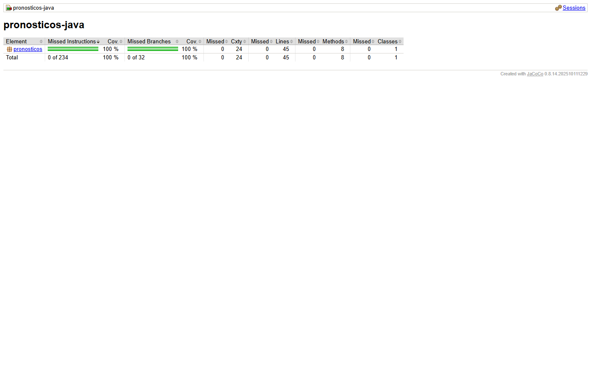

# Informe de la actividad — Valentina Barreto

## Repositorio y evidencias

- Repositorio propio: **pendiente de indicar la URL**.
- Pipeline rojo en GitHub Actions: **pendiente de ejecución y captura**.
- Pipeline verde en GitHub Actions: **pendiente de ejecución y captura**.
- Reporte de cobertura: `target/site/jacoco/index.html` después de `mvn clean verify`.
- Evidencias locales de TDD: carpeta [docs/evidencias](docs/evidencias).

### Resultados locales comprobados

`mvn clean verify` terminó con `BUILD SUCCESS`: **36 pruebas**, sin fallos ni
errores (33 casos unitarios y 3 escenarios BDD). Checkstyle reportó cero
infracciones. JaCoCo registró **45/45 líneas y 32/32 ramas cubiertas (100 %)**
en `CalculadoraPronosticos`, por encima del mínimo de 90 %.

| Comprobación | Resultado observado | Evidencia |
|---|---|---|
| Método ausente | Error de compilación `cannot find symbol` | [Rojo TDD](docs/evidencias/01-tdd-rojo.log) |
| Implementación inicial | 11 pruebas correctas | [Verde TDD](docs/evidencias/02-tdd-verde.log) |
| Validaciones ausentes | 6 fallos de los casos nuevos | [Rojo de validaciones](docs/evidencias/03-validaciones-rojo.log) |
| Validaciones implementadas | 20 pruebas correctas | [Refactor](docs/evidencias/04-tdd-refactor.log) |
| Importación sin usar | Falla `UnusedImports` | [Checkstyle rojo](docs/evidencias/06-checkstyle-rojo.log) |
| Cambio de `>=` a `>` | 4 fallos: igualdad a 10, extremos 0 y 100, escenario BDD de igualdad | [Alertas rojo](docs/evidencias/07-alertas-rojo.log) |
| Solo ejecutar MadTest | Falla JaCoCo: ratio de líneas 0.24 y ramas 0.18, mínimo 0.90 | [Cobertura roja](docs/evidencias/08-cobertura-rojo.log) |
| Código restaurado y compilación limpia | 36 pruebas correctas y cobertura aprobada | [Verificación final](docs/evidencias/09-verificacion-final.log) |

Las salidas locales no acreditan una ejecución remota del pipeline. Los pasos para
completar las evidencias están en [docs/ENTREGA.md](docs/ENTREGA.md).

## Respuestas para revisar y expresar con palabras propias

### ¿Qué ocurrió en el rojo de TDD?

El compilador reportó `cannot find symbol` al invocar `suavizacionExponencial`.
La prueba se escribió antes del método. Java comprueba que los métodos existan
durante la compilación, por lo que ni siquiera pudo ejecutar esa prueba.
Después se implementó la fórmula y las 11 pruebas de ese momento pasaron.
El resultado sin redondear es 137.55456; la tabla lo presenta como 137.5546.
Se usa la tolerancia 0.01 que indica la guía.

### ¿Por qué el MAPE de [80, 0, 95] se divide entre dos?

El periodo cuya demanda real es cero se excluye porque su error porcentual
implicaría dividir entre cero. Quedan dos periodos válidos:
`(0 / 80 × 100 + 5 / 95 × 100) / 2 = 2.631578... %`.
Dividir entre tres reduciría artificialmente el error.

### ¿Por qué se crea la calculadora con new?

Sus operaciones son Java puro y no dependen de Spring, una base de datos ni un
servidor. Crear la clase directamente permite comprobar la lógica con pruebas
rápidas, aisladas y repetibles.

### ¿Qué diferencia hay entre unitarias y BDD aquí?

Las pruebas unitarias comprueban métodos, cálculos y excepciones con JUnit.
Los escenarios BDD expresan la regla de alerta en español, mediante Dado,
Cuando y Entonces. Cucumber conecta esas frases con llamadas a la calculadora
y aserciones. En este proyecto los escenarios BDD comprueban negocio; no son
pruebas HTTP ni levantan Spring.

### ¿Qué debe ocurrir al cambiar >= por >?

En la comprobación local fallaron el caso de igualdad a 10, los dos casos de
umbrales extremos (0 y 100) y el escenario BDD de igualdad. La regla exige una
alerta cuando error y umbral coinciden. El job de cobertura también
ejecuta estas pruebas. El despliegue depende de los cuatro jobs mediante `needs`,
así que una verificación fallida impide su ejecución. La evidencia remota de
este comportamiento está pendiente; no se presenta como una ejecución observada.

## Alcance de las verificaciones

Checkstyle revisa fuentes de producción y de pruebas. JaCoCo debe exigir al menos
90 % en líneas y ramas de la lógica de negocio; esta condición se comprobó tanto
en verde como provocando cobertura insuficiente. Se conservan las exclusiones del
proyecto base para el controlador HTTP y el arranque de Spring; por ello la
cobertura de la calculadora no equivale a cobertura de toda la API.
