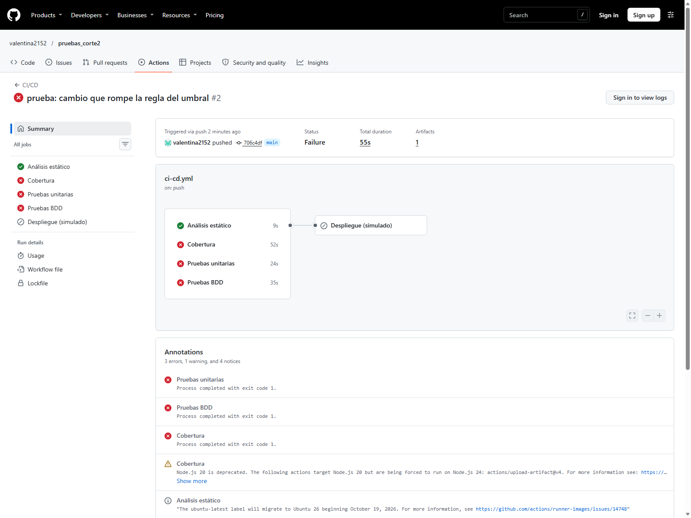
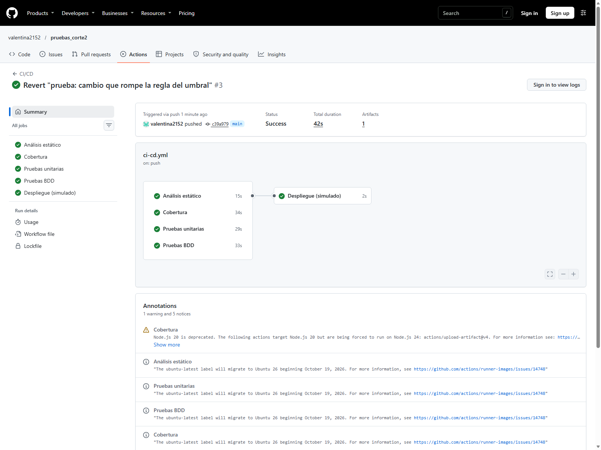

# Informe de la actividad — Valentina Barreto

## Actualización de los requisitos

Se incorporó la actualización del profesor `59db024`, que añade los ejemplos
BDD de promedio móvil, las guías de TDD y análisis estático y un nuevo Paso 8.
La entrega ahora indica **10 de noviembre de 2026, 11:59 p. m.**

Los requisitos nuevos se desarrollaron así:

- 8.1: `mse` tiene cuatro pruebas y nueve commits que muestran los ciclos rojo, verde y refactor.
- 8.2: [tres casos nuevos y su tabla de riesgos](docs/CASOS_PROPIOS.md), implementados en `CasosPropiosTest`.
- 8.3: `desviacion_porcentual.feature` comprueba la exclusión de demanda cero en MAPE.
- 8.4: regla `EmptyStatement`, con [fallo provocado](docs/evidencias/regla-propia-rojo.log) y [corrección verificada](docs/evidencias/regla-propia-verde.log).
- 8.5: [checklist completo y tres hallazgos](docs/REVISION_ESTATICA.md).
- Paso 9: [respuestas de la práctica y Definition of Done](docs/PRACTICA_PROPIA.md).

La primera prueba de MSE define el cálculo del requisito; después se comprueban
pronósticos exactos y cada validación por separado. La justificación de 143.15
frente a 143.22, la decisión propuesta sobre redondeo y la participación de quien
prueba están explicadas en el documento de práctica propia enlazado arriba.

La regla `EmptyStatement` detectó una sentencia vacía introducida deliberadamente.
Al quitarla, Checkstyle no encontró infracciones en producción ni pruebas, incluido
el código existente. No fue necesario suprimir ninguna advertencia.

Los resultados de 36 pruebas documentados abajo corresponden a la versión
anterior a esta actualización. Se conservan como evidencia histórica.

La verificación de la actualización (`mvn clean verify`) pasó con **39 pruebas:
33 unitarias y 6 escenarios BDD**, sin fallos ni errores; Checkstyle y el mínimo
de JaCoCo también pasaron. Registro: [actualización del profesor](docs/evidencias/10-actualizacion-profesor.log).

## Repositorio y evidencias

### Verificación completa del Paso 8

`mvn clean verify` terminó con **47 pruebas correctas: 40 unitarias y 7 escenarios
BDD**, cero errores y cero omisiones. Checkstyle no reportó infracciones.
JaCoCo alcanzó **51/51 líneas y 34/34 ramas (100 %)** de la calculadora, incluido
MSE. [Registro completo](docs/evidencias/11-paso8-completo.log).

- Repositorio propio: [valentina2152/pruebas_corte2](https://github.com/valentina2152/pruebas_corte2).
- Pipeline rojo en GitHub Actions: [ejecución 43120102531](https://github.com/valentina2152/pruebas_corte2/actions/runs/43120102531), commit `706c4df`. Fallaron unitarias, BDD y cobertura; el despliegue quedó `skipped`.
- Pipeline verde tras revertir el fallo: [ejecución 43120295469](https://github.com/valentina2152/pruebas_corte2/actions/runs/43120295469), commit `c39a979`. Los cuatro controles y el despliegue terminaron en `success`.
- Reporte de cobertura: `target/site/jacoco/index.html` después de `mvn clean verify`.
- Evidencias locales de TDD: carpeta [docs/evidencias](docs/evidencias).

### Capturas reales de GitHub Actions

El fallo deliberado se publicó en `main` y luego se revirtió con `git revert`.
La secuencia completa fue verde (`2747d78`), rojo (`706c4df`) y verde (`c39a979`).

Los resultados de la API pública también se conservan en
[github-verde.json](docs/evidencias/github-verde.json) y
[github-verde-jobs.json](docs/evidencias/github-verde-jobs.json).

### Resultados locales anteriores al Paso 8

`mvn clean verify` terminó con `BUILD SUCCESS`: **36 pruebas**, sin fallos ni
errores (33 casos unitarios y 3 escenarios BDD). Checkstyle reportó cero
infracciones. JaCoCo registró **45/45 líneas y 32/32 ramas cubiertas (100 %)**
en `CalculadoraPronosticos`, por encima del mínimo de 90 %.

| Comprobación | Resultado observado | Evidencia |
|---|---|---|
| Método ausente | Error de compilación `cannot find symbol` | [Rojo TDD](docs/evidencias/01-tdd-rojo.log) |
| Implementación inicial | 11 pruebas correctas | [Verde TDD](docs/evidencias/02-tdd-verde.log) |
| Validaciones ausentes | 6 fallos de los casos nuevos | [Rojo de validaciones](docs/evidencias/03-validaciones-rojo.log) |
| Validaciones implementadas | 20 pruebas correctas | [Refactor](docs/evidencias/04-tdd-refactor.log) |
| Importación sin usar | Falla `UnusedImports` | [Checkstyle rojo](docs/evidencias/06-checkstyle-rojo.log) |
| Cambio de `>=` a `>` | 4 fallos: igualdad a 10, extremos 0 y 100, escenario BDD de igualdad | [Alertas rojo](docs/evidencias/07-alertas-rojo.log) |
| Solo ejecutar MadTest | Falla JaCoCo: ratio de líneas 0.24 y ramas 0.18, mínimo 0.90 | [Cobertura roja](docs/evidencias/08-cobertura-rojo.log) |
| Código restaurado y compilación limpia | 36 pruebas correctas y cobertura aprobada | [Verificación final](docs/evidencias/09-verificacion-final.log) |

La ejecución remota roja se comprobó mediante GitHub Actions y su API pública.
Los resultados completos están en [github-rojo.json](docs/evidencias/github-rojo.json)
y [github-rojo-jobs.json](docs/evidencias/github-rojo-jobs.json).
El cambio incorrecto se revirtió mediante el commit `c39a979`.

## Respuestas para revisar y expresar con palabras propias

### ¿Qué ocurrió en el rojo de TDD?

El compilador reportó `cannot find symbol` al invocar `suavizacionExponencial`.
La prueba se escribió antes del método. Java comprueba que los métodos existan
durante la compilación, por lo que ni siquiera pudo ejecutar esa prueba.
Después se implementó la fórmula y las 11 pruebas de ese momento pasaron.
El resultado sin redondear es 137.55456; la tabla lo presenta como 137.5546.
Se usa la tolerancia 0.01 que indica la guía.

### ¿Por qué el MAPE de [80, 0, 95] se divide entre dos?

El periodo cuya demanda real es cero se excluye porque su error porcentual
implicaría dividir entre cero. Quedan dos periodos válidos:
`(0 / 80 × 100 + 5 / 95 × 100) / 2 = 2.631578... %`.
Dividir entre tres reduciría artificialmente el error.

### ¿Por qué se crea la calculadora con new?

Sus operaciones son Java puro y no dependen de Spring, una base de datos ni un
servidor. Crear la clase directamente permite comprobar la lógica con pruebas
rápidas, aisladas y repetibles.

### ¿Qué diferencia hay entre unitarias y BDD aquí?

Las pruebas unitarias comprueban métodos, cálculos y excepciones con JUnit.
Los escenarios BDD expresan la regla de alerta en español, mediante Dado,
Cuando y Entonces. Cucumber conecta esas frases con llamadas a la calculadora
y aserciones. En este proyecto los escenarios BDD comprueban negocio; no son
pruebas HTTP ni levantan Spring.

### ¿Qué debe ocurrir al cambiar >= por >?

En la comprobación local fallaron el caso de igualdad a 10, los dos casos de
umbrales extremos (0 y 100) y el escenario BDD de igualdad. La regla exige una
alerta cuando error y umbral coinciden. El job de cobertura también
ejecuta estas pruebas. El despliegue depende de los cuatro jobs mediante `needs`,
así que una verificación fallida impide su ejecución. En GitHub se observó el
fallo de unitarias, BDD y cobertura y la omisión del despliegue en la ejecución
43120102531. Checkstyle pasó porque el cambio era sintácticamente válido:
las pruebas detectaron el error de negocio que el análisis de estilo no detecta.

## Alcance de las verificaciones

Checkstyle revisa fuentes de producción y de pruebas. JaCoCo debe exigir al menos
90 % en líneas y ramas de la lógica de negocio; esta condición se comprobó tanto
en verde como provocando cobertura insuficiente. Se conservan las exclusiones del
proyecto base para el controlador HTTP y el arranque de Spring; por ello la
cobertura de la calculadora no equivale a cobertura de toda la API.

## Desarrollo y respuestas del Paso 8

#### Justificación de las decisiones

### MSE y TDD

La primera prueba usa las demandas [141, 138, 150] y los pronósticos
[126.67, 133.67, 135.67], porque verifica la fórmula con el ejemplo acordado.
El cálculo independiente es `(205.3489 + 18.7489 + 205.3489) / 3 = 143.1489`,
que se presenta como 143.15 con dos decimales.

El segundo caso exige cero con pronósticos exactos; detecta una implementación
que solo devuelva la constante del primer ejemplo. Después se agregan, de a una,
las pruebas de longitudes distintas y series vacías, verificando también los
mensajes. El refactor reutiliza `validarSeries` y nombra la suma de cuadrados.
Los commits y los registros `docs/evidencias/mse-*.log` documentan el orden real.

El valor 143.22 corresponde a usar pronósticos sin redondear (380/3, 401/3 y
407/3); no es el resultado para los datos de dos decimales de la tabla.
Producción debería conservar la precisión completa durante los cálculos y
redondear solo al presentar resultados. Si el dato de entrada almacenado ya
está redondeado a dos decimales, debe calcularse 143.15: el sistema no puede
recuperar una precisión que no recibió. La política de redondeo debe acordarse
con Producción y quedar en los criterios de aceptación.

### Casos nuevos

El diseño previo y los cálculos están en [CASOS_PROPIOS.md](docs/CASOS_PROPIOS.md).
Se comprueban decimales en promedio móvil, exclusión de datos anteriores a la
ventana y ausencia de cancelación entre errores de signos opuestos en MAD.

### Regla de negocio del escenario propio

Se elige la exclusión de periodos con demanda cero al medir la desviación
porcentual. Está implementada en `CalculadoraPronosticos.mape`: omite el periodo
y divide entre los periodos válidos, no entre todos los periodos recibidos.

El escenario usa demandas 80, 0 y 95 y pronósticos 80, 0 y 100; espera 2,63 %.
Es una prueba funcional porque verifica un requisito con entradas y resultado
observables por Producción. Las frases no describen llamadas a métodos ni
detalles de implementación. Sus pasos ejecutan Java puro, por lo que no es una
prueba de interfaz HTTP. El idioma español exige coma en `2,63` para `{double}`.

### Regla propia de Checkstyle

Se agrega `EmptyStatement` dentro de `TreeWalker`, distinta de las reglas usadas
como ejemplos de configuración en la guía. Detecta sentencias vacías (`;`)
que pueden ser un error accidental, por ejemplo después de un condicional.
Se aplica tanto a producción como a pruebas, sin exclusiones ni supresiones.

La comprobación controlada agrega un `;` independiente al comienzo de `mse`,
ejecuta Checkstyle y exige que el error mencione `EmptyStatement`. Luego restaura
el código y vuelve a ejecutar el análisis. El resultado y el estado del código
existente se registran en el informe final.

Referencia: [documentación oficial de EmptyStatement](https://checkstyle.org/checks/coding/emptystatement.html).

### Definition of Done y participación de quien prueba

- Criterios de aceptación acordados con Producción, incluidos límites, entradas
  inválidas, unidades y política de redondeo.
- Implementación revisada y commits TDD que evidencien rojo, verde y refactor.
- Pruebas unitarias y escenarios BDD ejecutados automáticamente y sin fallos.
- Checkstyle sin infracciones y JaCoCo con al menos 90 % de líneas y ramas de
  negocio, con el alcance de las exclusiones explícito.
- Ejecución roja que bloquee el despliegue y posterior ejecución verde que lo habilite.
- Informe, reportes, capturas y enlaces disponibles en el repositorio propio.

Quien prueba participa desde el refinamiento: ayuda a definir ejemplos y casos
límite antes de programar. Durante el desarrollo revisa el diseño de pruebas y
las regresiones, y antes de cerrar la historia comprueba los criterios de
aceptación y las evidencias del pipeline. No se deja toda la validación para el
final del sprint.

### Tabla de los tres casos propios

Casos definidos antes de escribir sus pruebas. No aparecen en los tests ni en
los ejemplos resueltos del profesor.

| Función | Entrada | Resultado calculado a mano | Riesgo cubierto |
|---|---|---|---|
| promedioMovil | serie [2.25, 3.75], ventana 2 | (2.25 + 3.75) / 2 = 3.00 | Truncar los decimales antes de sumar daría 2.50. |
| promedioMovil | serie [9000, 2, 4], ventana 2 | (2 + 4) / 2 = 3.00 | Incluir valores anteriores a la ventana contaminaría el pronóstico. |
| mad | real [10, 20], pronóstico [14, 16] | (abs(-4) + abs(4)) / 2 = 4.00 | Sumar errores con signo los cancelaría y devolvería cero. |

No se modificará el resultado esperado para acomodarlo a una implementación.

### Checklist de revisión estática

Revisión por lectura del método existente, sin ejecutarlo. Referencias a
`src/main/java/pronosticos/CalculadoraPronosticos.java`, después del refactor de
MSE (`ae5e5e5`). No se modifica la regla de negocio como parte de esta revisión.

| # | Pregunta | Respuesta | Evidencia y explicación |
|---|---|---|---|
| 1 | ¿El nombre dice qué hace? | Sí | Línea 109: `debeGenerarAlerta` expresa una decisión booleana sobre la alerta. |
| 2 | ¿Los nombres indican qué contienen? | Sí | Línea 109: `errorPorcentual` identifica la unidad; `umbral` es el límite usado en la comparación. |
| 3 | ¿Tiene una sola responsabilidad? | No, estrictamente | Líneas 110–111 validan el umbral y la 113 decide la alerta. La validación es breve y local, pero son dos tareas distinguibles. |
| 4 | ¿Repite lógica existente? | No | Líneas 110–113: no hay otra validación del intervalo porcentual 0–100 en la clase; la validación de alfa usa otro dominio. |
| 5 | ¿Hay números que deberían tener nombre? | Sí | Línea 110: `100` representa el máximo porcentual permitido; una constante comunicaría ese significado. |
| 6 | ¿Los comentarios explican el porqué? | Sí | Líneas 106–107: explican el acuerdo con Producción de incluir la igualdad, una decisión que podría confundirse con `>`. |
| 7 | ¿Cada dato inválido produce un error explícito? | No | Líneas 110–111: solo se rechaza el umbral menor que 0 o mayor que 100. `NaN` no satisface ninguna comparación; tampoco se valida un error porcentual negativo o no finito. |
| 8 | ¿Se entiende de una lectura? | Sí | Líneas 110–113: un `if` con dos condiciones unidas por OR y una comparación de resultado. Complejidad ciclomática 3 (base 1 + if + OR). |
| 9 | ¿Cada comportamiento tiene una prueba? | No, para entradas no definidas | `AlertasTest` cubre menor, igual, mayor, extremos 0/100 y umbrales inválidos -1/150. No hay casos de NaN, error negativo ni infinitos. |

### Hallazgos de la revisión

1. **El umbral NaN no se rechaza** (línea 110). Por las reglas de comparación de
   `double`, ambas condiciones son falsas, y la comparación final tampoco activa
   la alerta. Un valor sin significado numérico podría pasar inadvertido.
   Propuesta: acordar rechazo de datos no finitos, escribir primero la prueba y
   luego validar con `Double.isFinite`.
2. **El contrato del error porcentual está incompleto** (líneas 109 y 113).
   No especifica qué hacer ante valores negativos, NaN o infinitos. Se podría
   ocultar una entrada errónea o generar una alerta por un infinito.
   Propuesta: acordar con Producción que el error sea finito y no negativo,
   sin limitarlo automáticamente a 100 porque un MAPE sí puede superar 100 %.
   Después añadir pruebas antes de cambiar la implementación.
3. **Límite porcentual sin nombre** (línea 110). Propuesta: una constante
   `UMBRAL_MAXIMO_PORCENTUAL` para expresar el significado del 100 si se refactoriza.

No se cambió el contrato en esta revisión: la guía permite registrar propuestas.
Checkstyle puede detectar problemas de forma, pero estas reglas configuradas no
deducen qué datos debería aceptar Producción ni la consecuencia de una alerta
silenciosamente omitida. Esos son los hallazgos que aporta la lectura del dominio.
